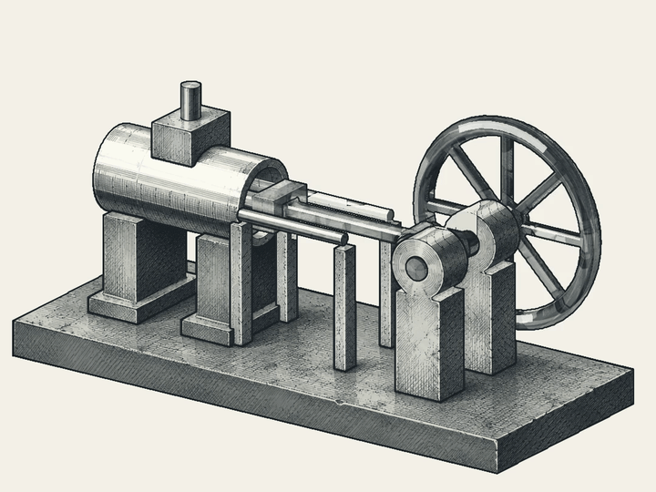

# an-agent

<p align="center">
  
</p>

An experimental Rust framework for embedding event-driven agents into existing applications.

Instead of making people work through a separate AI interface, an-agent explores how agents can participate directly in ordinary software workflows. Changes to a document, model, or canvas can trigger bounded assistance, without requiring a new prompt for every action.

The application remains the working environment. The host owns execution, users retain control over their editable documents, and agents operate through explicitly declared capabilities.

The framework provides execution coordination, semantic assessment, supervision, and inspectable evidence. It does not assume that recorded actions are reversible, that external state can always be recovered, or that semantic checks alone provide a security boundary.

This is an early-stage library and integration effort, not a finished creative application.

A spool is the domain execution isolation and lifecycle boundary; internal
**silks** implement its callable steps. OpenShell is a replaceable execution
backend, and application shuttles remain host-authorized external bridges.
See the [implementation audit and staged migration](crates/an-agent-host/SPOOL-BOUNDARY.md).
Existing bounded execution profiles do not yet provide a multi-silk runtime.

The [spool code contract](doc/spool-code.md) distinguishes **silks**, the stable pipeline
skeleton and core domain code, from **kits**, adaptable internal glue. Published
packages remain immutable; agent edits apply only to authorized working copies.
This vocabulary does not add runtime enforcement or change legacy CLI/API tokens.

## Current demonstration



A mechanical drawing experiment separates prescribed mechanism motion from its drawing treatment. The geometry supplies the poses and visibility; an ink treatment follows those poses. The working artifacts include editable SVG and layered OpenRaster drawings. AI-generated bitmap references contribute surface appearance, not the mechanism's motion.

This is an independent workflow prototype informing the framework's direction, not an end-to-end feature of the Rust kernel. The ink study shows four repetitions of one operating cycle, not an assembly sequence or a force simulation. It does not demonstrate automatic propagation of arbitrary painting edits, live CAD synchronization, or full recovery from the event log.

## Documentation

Start with the [public documentation](doc/README.md) for architecture, spool/silk
execution boundaries, state/artifact ownership and implementation status. Detailed
contracts remain beside the crates that implement them.

The [native workspace event contract](crates/an-agent-host/NATIVE-EVENTS.md)
connects accepted file versions to explicitly approved headless spool deliveries.
Business workflows stay inside silks/kits; the host adds no business graph DSL.

## Architecture and current capabilities

The host application owns the workspace, user interaction, and execution of application-specific effects. Today, spools are embedded capability bodies with declared contracts and configuration. The target packaging model is a reusable workflow package containing stages, silks, configuration and documentation; it requests shuttle capabilities rather than necessarily containing a shuttle. A spool carries domain knowledge, business rules, skills and domain acceptance criteria; the host supplies generic execution and artifact management rather than absorbing those rules. Package identity, a workflow run and an individual stage are distinct. The existing descriptor and mounting APIs are not changed by this design direction.

Loom owns development and packaging. The an-agent host owns workflow admission, scoped context/model services and accepted artifacts; an execution backend enforces isolation and owns VM/process lifecycle. Shuttles remain application-side bridges, not unrestricted host shells. See [the responsibility and permission boundaries](crates/an-agent-host/ARCHITECTURE.md) and [the local VM direction and capability limits](crates/an-agent-host/LOCAL-VM.md). Local execution is the priority; no remote orchestration platform is required.

- **Workspace integration:** events, configuration, environment snapshots, and registration provide the host-facing context. The workspace is the interaction center; its durable documents and assets remain essential inputs.
- **Agent execution:** `AgentControl` coordinates mounted bodies, model and tool boundaries, hooks, and recorded outcomes. The host supplies model clients and native integrations.
- **Semantic checks:** a separate crate represents claims, concrete attempts, version-bound grants, receipts, contract assessments, and dependency validity. It does not own business scheduling or user interaction. Trusted adapters determine what evidence and enforcement are actually available.
- **Supervision:** operations requiring review can yield to a live supervisor. Approvals are bound to the exact operation and current authority; explicit denial or missing capabilities cannot be bypassed through approval. Changes to relevant live state invalidate affected reviews.
- **Audit and limited recovery:** append-only tapes retain execution evidence, while session APIs support bounded recovery with required inputs available. Dependency checks can quarantine stale model results rather than treating them as current work.
- **Bounded CLI hosting:** `an-agent-host` independently registers hash-bound deployments and runs an explicit stdio-only capability through admission, native macOS restrictions, and retained receipts. Development and packaging tools are not runtime dependencies. See [the host execution contract](crates/an-agent-host/README.md).

Release-bound native spools also support explicit workspace-event handoff and
[operator-selected Python with binary products](crates/an-agent-host/NATIVE-PYTHON.md).
The headless log-report example produces editable XLSX/PPTX through the same
supervision and custody boundary; document rules remain in spool code.

Semantic assessment and execution enforcement are distinct. The host or supervising agent decides how to respond to findings; trusted execution boundaries enforce permissions. A declaration or a recorded receipt is not, by itself, an operating-system sandbox.

## Boundaries

The tape is an audit record, not a backup of the entire world. It cannot reconstruct a missing spool implementation, restore an unavailable model or external service, or guarantee faithful recovery after long periods. Retaining required packages, workspace assets, and compatible dependencies remains the deployer's responsibility.

The content-addressed workspace store is not a complete document-versioning or rollback system. Memory provenance does not establish truth or a calibrated confidence score. External effects are not automatically reversible or safe to retry. General static effect inference, comprehensive OS isolation, durable approval recovery, distributed execution, and seamless creative-tool integration remain work ahead.

## Layout

- `crates/an-agent-core` — the kernel: tape, admission, identity, `AgentControl`, seats, and the recorder file workspace.
- `crates/an-agent-host` — embedding helpers, spool construction, reply-intent execution, and a model-client adapter.
- `crates/an-agent-factory` — bash registration and `BuiltAgent` construction. `spawn` returns an `Agent` and is not the host face.
- `crates/an-agent-context` — per-session context assembly. The shared pool is not in this crate.
- `crates/an-agent-semantic` — transport-neutral claims, concrete attempts, version-bound assessments, grants, and execution receipts. It owns no scheduling or interruption. Core execution boundaries retain evidence and return supervisor requests for blocked operations.
- `crates/an-agent-supervision` — transport-neutral live review state and exact one-shot approvals. It owns no tape, execution, or scheduling; core adapts trusted execution boundaries to it.
- `crates/an-agent-spool` — capability spools: YAML descriptor admission and the append-only spool registry.
- `crates/an-agent-workspace` — content-addressed store. It is not the recorder workspace.
- `packages/causal-web` — zero-dependency tape viewer: drop in a `.jsonl` tape, see the causal threads, get the tape validated in-page.
- `packages/lean-probe` — tiny Lake package from a Lean 4 compatibility experiment (no Mathlib).
- `doc/` — public architecture, execution, state/artifact and implementation-status guides.
- `config/` — model endpoint configuration.
- `assets/demos/` — presentation media, separate from runtime capabilities.

## Develop

```sh
cargo check --workspace --all-targets
cargo test --workspace
cargo clippy --workspace --all-targets
cargo fmt --all -- --check
cargo arch
```

The toolchain is pinned via `rust-toolchain.toml`. Experiments stay outside the product dependency graph. Promote a proven integration through a tested implementation, rather than treating a successful standalone demo as a kernel guarantee.

See [architecture gates](ARCHITECTURE-GATES.md) for the TOML rules, existing-debt
baseline, dependency boundaries and the separately locked SPACE-based checker.

The [implementation boundary audit](doc/architecture.md#implementation-boundary-audit) maps current modules to developer, host, and backend responsibilities and records the remaining limits.

See [Weaver and independent spool development](doc/weaver.md) for the separation
between standalone iteration and platform-managed execution.
