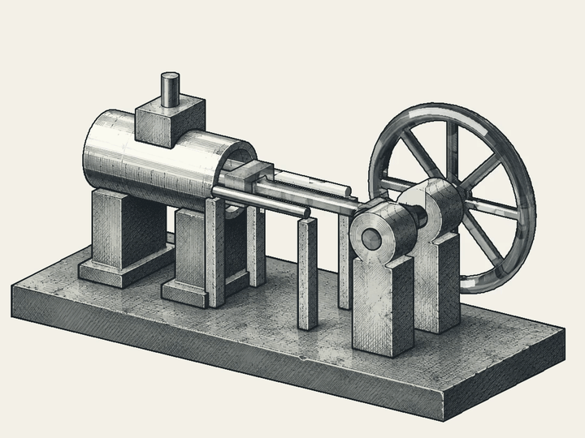
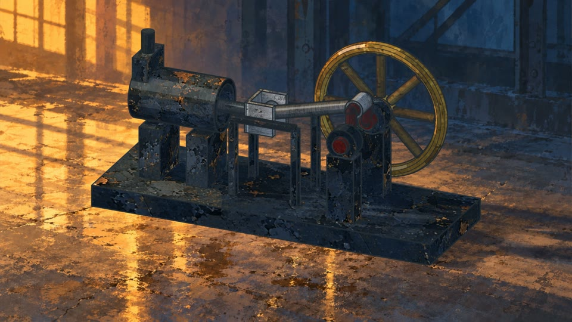
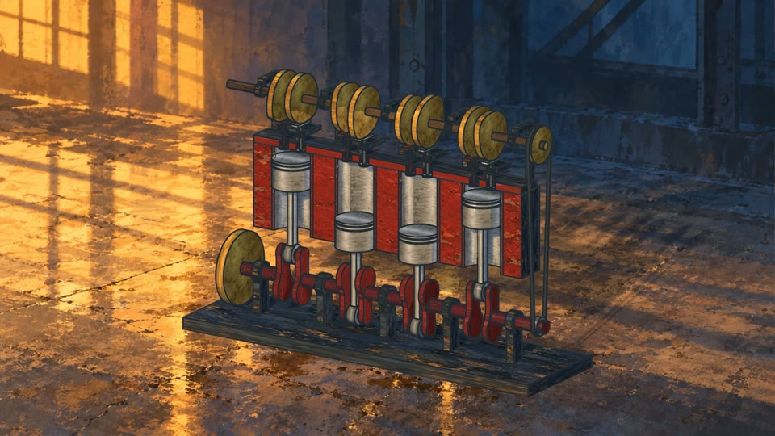

# an-agent

English · [简体中文](doc/zh-CN/README.md)

A local agent runtime for application workflows, with a macOS user service,
lightweight scheduling and external harness delegation.

an-agent owns task authority, original execution supervision, spool lifecycle,
activity records and accepted artifacts. External harnesses own their model loops.
Domain instructions and business acceptance belong to spools; application bridges
remain in Shuttle. The service reuses `ExecutionBackend` and the existing supervisors.

## Use and observe

Build `an-agent-host` with `cargo build --release --locked --bin an-agent-host`.
Follow [the user service guide](doc/daemon.md) to start the foreground service or
prepare a LaunchAgent, inspect the local console, delegate work and read results.

Task permissions travel with delegated work, can narrow and expire, and can be
revoked. Cancellation reaches the original owner; unknown termination is not a
successful cleanup. [Execution contracts](doc/execution.md) and
[platform qualification](doc/platforms.md) describe enforcement and limits.
The local operator boundary trusts the same OS user; remote model termination
is not inferred from a local client exit.

## Repository boundaries

| Project | Owns |
| --- | --- |
| an-agent | Authority, scheduling, supervision, lifecycle, activity and custody |
| [an-loom](https://github.com/lazyalexander/an-loom) | Authoring, validation and packaging |
| [an-spool](https://github.com/lazyalexander/an-spool) | Reviewed domain knowledge and implementations |
| [an-shuttle](https://github.com/lazyalexander/an-shuttle) | Application snapshots, interaction and product delivery |

Every immutable release baseline is **silk**. Authorized modified or new files
are **kit**, subject to retention or reclamation after confirmed settlement.
Instructions remain protected. Labels never grant execution authority.
See [the content contract](doc/spool-code.md).

The [CAD → Krita integration](https://github.com/lazyalexander/an-shuttle/blob/main/docs/cad-paint.md)
provides the existing native execution and editable-artifact acceptance reference.

## Develop

```sh
cargo test --workspace
cargo clippy --workspace --all-targets
cargo fmt --all -- --check
cargo arch
```

See [documentation](doc/README.md), [architecture](doc/architecture.md),
[testing](doc/testing.md), and [quality gates](doc/quality.md).
The separate architecture checker and real host acceptance are required where
applicable; ordinary unit tests do not establish application or provider behavior.

## Cases · mechanical animation

### Ink and painted steam-engine comparison

| Ink animation | Painted version · 6 s |
| --- | --- |
|  | [](assets/demos/painted-steam-engine.mp4) |

Compare line-based mechanical presentation with AI-created surface textures and
a painted background, animated through prescribed geometry and motion.
[Teaching guide and reproduction evidence](doc/cases.md).

### Supplementary case · inline-four engine

<a href="assets/demos/painted-inline-four.mp4"></a>

Forty CAD parts and an eight-second cycle reuse the painted workflow.
[Motion, checks and integration stages](doc/cases.md#supplementary-case--inline-four).
