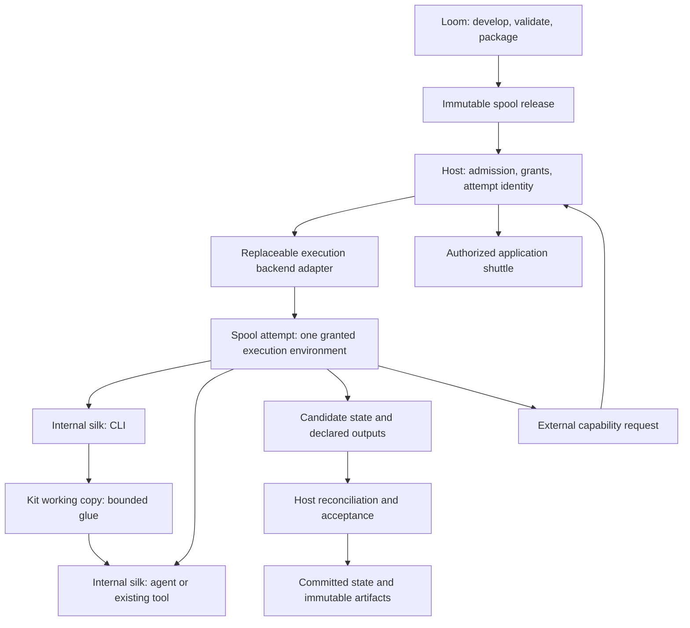

# Spool execution boundary and internal silks

Status: accepted architecture; existing bounded execution profiles remain in
place. This document does not claim a multi-silk runtime or change any grant.

## Objects and authority

A spool release is an immutable domain package: workflow code, internal silks,
skills, configuration, dependency bindings and domain validation. A spool instance
binds a release and committed business state. A spool execution attempt is the
host-owned unit of execution isolation, resource ownership and lifecycle.
Several silks can run inside that one attempt's granted environment.

A silk is release-bound core domain implementation and pipeline skeleton,
implemented by a script, binary, existing tool or agent. It is read-only during
an attempt; changing its development source requires a new validated release. It does not independently acquire a host identity, grant,
VM, credential or artifact catalog. A reusable silk may be shared in development,
but managed execution must bind its selected bytes to the owning spool release.
Independent CLI use remains possible outside an-agent and carries no host guarantee.

The host admits a spool attempt and selects its backend. Silks inherit at most
the attempt's effective authority. An inner call does not create a new sandbox
by default. Isolation between mutually distrusting silks requires an explicit,
separately authorized boundary; it is not implied by their names or call count.
Separate spool attempts must not share writable execution environments implicitly.

OpenShell is an optional backend below host execution authority, not a mandatory
runtime, a semantic dependency or a per-silk wrapper. Native enforcement remains
available within its qualified profiles. No unavailable or insufficient backend
may silently fall back to weaker execution. A VM label does not establish all
filesystem, network, credential or termination guarantees.

Semantic assessment receives transport-neutral facts and returns findings. It
neither imports OpenShell nor owns scheduling, cancellation or authorization.
The host evaluates findings and enforces hard ceilings; backend adapters translate
policy and observations, never domain meaning or publication authority.

## State and lifetime

The lifecycle belongs to the spool attempt, not to each silk subprocess. A silk
exit does not prove that the environment's other workers have stopped. Cancellation
and timeout concern the whole owned attempt. An unconfirmed termination fences
publication, continuation and reclamation. A stale environment generation cannot
submit results for a replacement attempt.

The host retains committed instance state, official artifacts and boundary
receipts outside the disposable environment. Internal files are scratch unless
explicitly retained for recovery. Stopping or replacing the environment does not
change committed state, restore process memory or reverse external effects.
A future commit during a live attempt requires its own coherent-checkpoint
contract; the current profiles still require successful terminal settlement.
External application changes stay behind host-authorized shuttles with revision
preconditions and actual-effect evidence.

## Implementation audit

| Existing surface | Actual scope | Gap to the target |
| --- | --- | --- |
| `execution/backend.rs` and `environment.rs` | Native/OpenShell delegation, operation identity, generation reconciliation and host-owned acceptance | Contract is internal and supports bounded one-program deployments, not an internal silk dispatcher |
| Embedded `SpoolBeat` bodies | Existing in-process host integration | No execution isolation is implied by mounting a body; retain as a trusted embedding surface, not an untrusted spool runner |
| Native stdio/file profiles | Release-bound entry executable, platform restrictions and process supervision | Do not widen grants to support arbitrary agents or internal workers |
| OpenShell file profile | One owned sandbox per invocation; stop and identity confirmation before accepting one candidate | Treat as a single-entry spool-attempt specialization, not a new VM per internal silk; shared internal execution is not implemented |
| Reviewed workspace jobs | Operator-selected trusted workflow, scratch and binary output custody | Separate acceptance/development surface; not a production spool authority or hostile-agent boundary |
| Model and application services | Separate host-controlled services and shuttle responsibilities | Do not inherit authority from an environment label or an internal silk request |

The [native spool slice](NATIVE-SPOOL.md) now binds a verified code release and
instance to the reviewed workspace engine. Its fixed shell profile and between-run
kit edits do not establish general agent containment or a multi-backend spool ABI.

## Qualified local boundary and deferred work

The native release facade binds code, instance, attempt, explicit input/state and
operator approval to the existing supervisor. Real two-silk/kit/two-instance
acceptance qualifies cancellation, baseline restoration and fixed product custody.
Workspace events add separately authorized inter-spool delivery; domain branches
and loops remain inside silk/kit. Developer-only workspace jobs remain visibly
separate from registered production profiles.

Native round-boundary pause and checkpoint/stop suspension do not imply live
process-memory suspension or VM restoration. Stronger containment, dependency
resolution, automatic migration and another backend require concrete demand and
separate qualification. Use [implementation status](../../doc/status.md) for the
current plan rather than treating completed migration steps as new work.

## Naming compatibility

The [spool code contract](../../doc/spool-code.md) assigns `kit` a distinct role:
adaptable glue inside a spool. A packaged kit baseline remains immutable; only
an explicitly editable working copy may change. Temporary copies are scratch
unless explicitly retained. No mutable-kit runtime is added by this contract.
Existing `file-kit-v1`, `build-kit`,
`kit.request`/`kit.execute`/completion events, source paths and Rust API spellings
are compatibility tokens until separately migrated with versioned acceptance.
They do not define an independent execution boundary.

Historical Silk protocol and Silksong records refer to the old communication
vocabulary. They are not executable silks and must not be decoded or relabelled
as such. Future communication contracts need distinct names or explicit schema
identities; this change does not migrate that protocol or rewrite its tape.
