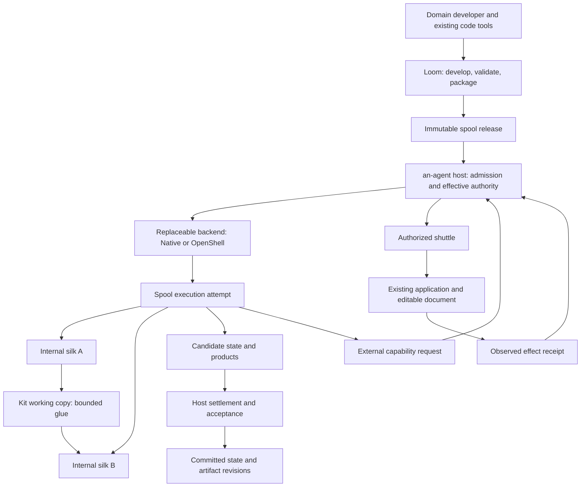

# Architecture and vocabulary

The goal is natural assistance inside existing applications. Users work on their
documents, models and canvases; host integrations supply bounded context and
request useful work. Text interaction remains available when intent or authority
needs clarification. Domain algorithms do not belong in the kernel.

## Responsibilities

| Component | Responsibility |
| --- | --- |
| an-agent host | Admission and grants, model/context services, execution identity, lifecycle coordination, committed state, accepted artifacts, delivery and retention evidence |
| Core | Existing event/tape, identity and admission/control primitives; not a domain pipeline engine or VM manager |
| Spool release | Immutable domain code, internal silks, skills, dependencies, state formats and domain acceptance rules |
| Spool instance | A release-bound business identity with committed state |
| Spool execution attempt | The target unit of execution isolation, authority and lifecycle |
| Silk | Release-bound core domain code and pipeline skeleton; read-only during an attempt |
| Kit | Adaptable internal glue; packaged baselines are immutable, explicitly editable working copies are scratch by default |
| Shuttle | An authorized bridge into an external application, with modification preconditions and observed results |
| Execution backend | Actual isolation and process/environment control; OpenShell is one optional implementation |
| an-loom | Developer workbench for authoring, code-tool assistance, checks and packaging; never runtime authorization |

This is the target responsibility model. Existing single-entry profiles cover
only a bounded specialization. In-process `SpoolBeat` bodies remain trusted
embedding code; mounting a declaration does not place that code in isolation.
A general multi-silk spool runtime is not implemented.

## Local execution strategy

Spool interaction is workspace-event routing, not a host business workflow graph.
Silk/kit owns domain branches, loops and delegation decisions. The host owns
subscriptions, admission, attempt supervision and fixed-version delivery evidence.
The [native event slice](../crates/an-agent-host/NATIVE-EVENTS.md) connects accepted
artifact facts to separately approved native attempts through explicit foreground
dispatch. It adds no graph DSL, background scheduler or low-latency channel.
The [native Python extension](../crates/an-agent-host/NATIVE-PYTHON.md) binds an
operator-selected environment and explicit binary products to that same boundary.
Spool packages declare requests; local runtime selection and grants stay host-owned.
Subagents use the same authority boundary; shuttles remain external-application
bridges. Future high-frequency data needs a separately granted channel rather
than forcing every sample into the durable workspace log or tape.

Own a lightweight spool execution manager, not a new container implementation.
Reuse the native backend first, with independently owned concurrent attempts.
Future container or microVM adapters provide enforcement and lifecycle evidence;
the host continues to own grants, accepted versions and inter-spool delivery.
Release identity, business state, live process state and filesystem backups are
distinct. A restart selects explicit inputs/state and creates a new attempt.

## Dependency and trust direction

Runtime crates do not depend on Loom or a domain workflow example. Domain
sequencing and checks stay in the spool. The host does not need to interpret
business state to retain and version it. Backend-specific policy/state is
translated by host adapters; it does not enter the pure semantic crate.

The spool requests capabilities; the host grants them. Package instructions,
source-analysis reports, generated YAML and model findings cannot create grants.
A silk cannot select a weaker backend or write directly to the formal catalog.
Backend support must be qualified for its platform, version and effective policy.
There is no silent weaker fallback when requirements cannot be enforced.

The [spool code contract](spool-code.md) distinguishes stable silks from adaptable
kits. This is a target contract, not new mutable-code enforcement. Legacy `file-kit-v1`, CLI
commands, `kit.*` events, paths and compatibility APIs retain their spelling.
Historical Silk communication protocol/Silksong records are a different schema,
not executable silks; no history is rewritten by the naming change.

For the detailed audit and migration, see [the spool boundary](../crates/an-agent-host/SPOOL-BOUNDARY.md).

## Implementation boundary audit

The runtime dependency direction matches the intended ownership: runtime Cargo
manifests do not depend on Loom, and Loom does not link runtime crates. Domain
algorithms remain in release payloads/examples. A generated declaration requests
capabilities; it cannot grant them. Registration publishes selected bytes without
activating an execution.

The host execution facade keeps its existing public functions and CLI:

| Module | Owns | Must not own |
| --- | --- | --- |
| `execution/deployment.rs` | Deployment validation and immutable registration | Execution authorization or domain compilation |
| `execution/mod.rs` | Public entrypoints and explicit backend selection | Inline backend implementation or packaging policy |
| `execution/attempt.rs` | Input selection, allocation lock, operation identity, backend result reconciliation, output acceptance and receipt | Domain algorithms or backend isolation mechanisms |
| `execution/admission.rs` | Kernel request/reply validation and final tape/audit settlement for the same attempt | Process spawning or artifact acceptance |
| `execution/backend/` | Native/OpenShell translation to the existing execution contract | Release assembly or independent grants |
| `settled_run`, `instance`, `artifact_versions`, `retention` | Evidence gates, committed state, product custody and collection | Interpretation of domain state or automatic recovery of external effects |

The attempt carries its admitted identity through receipt production into audit
settlement. Ordering is unchanged: selected input and plan, kernel admission,
operation intent, executable publication, backend result reconciliation, candidate
acceptance, receipt, audit and final settlement seal. A partial finish is not a
settled run. Shared allocation locking still ends before independent execution;
this refactor adds no global lifecycle lock, retries or weaker fallback.

Loom's host adapter is deliberately coupled to qualified CLI/receipt formats.
That is a development client dependency, not runtime ownership. Offline source
inspection and build-receipt validation are not sandbox enforcement. The host
still decides whether the received release and requested execution are admissible.

### Limits retained by this refactor

- Trusted in-process `SpoolBeat` embedding and isolated CLI attempts remain distinct
  paths. A declaration does not sandbox an in-process body.
- Deployment still supports bounded profiles, not arbitrary multi-silk releases or
  a general mutable-kit execution contract.
- Loom's host CLI transport is trusted operator tooling, not a sandbox for a
  model-selected executable. Its response-size check occurs after capture.
- No wire format, legacy name, CLI, permission scope or domain acceptance rule is
  migrated here. A new profile must earn integration evidence before broadening
  the interfaces; a generic plugin/control-plane framework is not a prerequisite.
