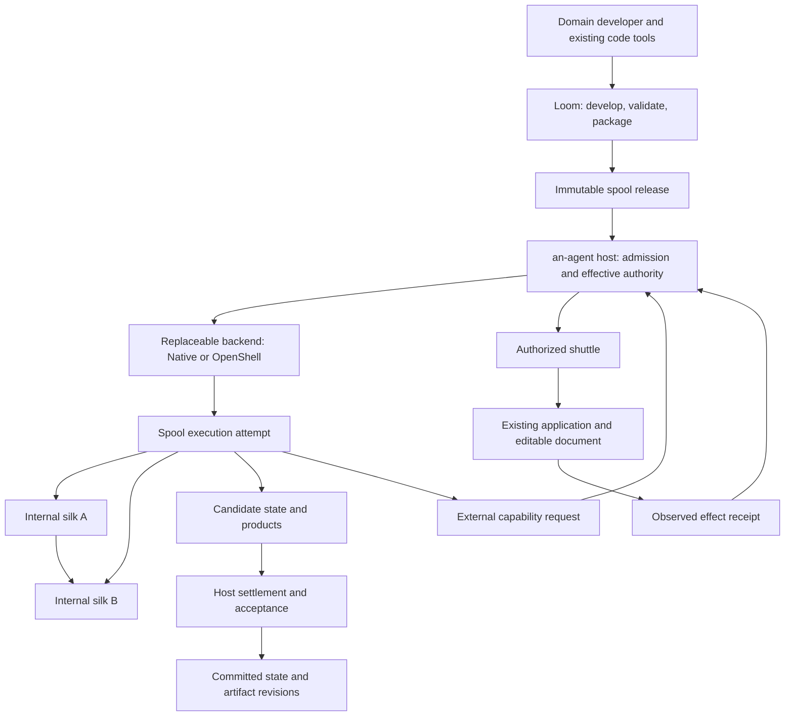

# Architecture and vocabulary

The goal is natural assistance inside existing applications. Users work on their
documents, models and canvases; host integrations supply bounded context and
request useful work. Text interaction remains available when intent or authority
needs clarification. Domain algorithms do not belong in the kernel.

## Responsibilities

| Component | Responsibility |
| --- | --- |
| an-agent host | Admission and grants, model/context services, execution identity, lifecycle coordination, committed state, accepted artifacts, delivery and retention evidence |
| Core | Existing event/tape, identity and admission/control primitives; not a domain pipeline engine or VM manager |
| Spool release | Immutable domain code, internal silks, skills, dependencies, state formats and domain acceptance rules |
| Spool instance | A release-bound business identity with committed state |
| Spool execution attempt | The target unit of execution isolation, authority and lifecycle |
| Silk | An internal callable CLI, script, program, existing tool or agent step; no independent VM or grant by default |
| Shuttle | An authorized bridge into an external application, with modification preconditions and observed results |
| Execution backend | Actual isolation and process/environment control; OpenShell is one optional implementation |
| an-loom | Developer workbench for authoring, code-tool assistance, checks and packaging; never runtime authorization |

This is the target responsibility model. Existing single-entry profiles cover
only a bounded specialization. In-process `SpoolBeat` bodies remain trusted
embedding code; mounting a declaration does not place that code in isolation.
A general multi-silk spool runtime is not implemented.

## Dependency and trust direction

Runtime crates do not depend on Loom or a domain workflow example. Domain
sequencing and checks stay in the spool. The host does not need to interpret
business state to retain and version it. Backend-specific policy/state is
translated by host adapters; it does not enter the pure semantic crate.

The spool requests capabilities; the host grants them. Package instructions,
source-analysis reports, generated YAML and model findings cannot create grants.
A silk cannot select a weaker backend or write directly to the formal catalog.
Backend support must be qualified for its platform, version and effective policy.
There is no silent weaker fallback when requirements cannot be enforced.

The current name `silk` replaces the callable `kit`. Legacy `file-kit-v1`, CLI
commands, `kit.*` events, paths and compatibility APIs retain their spelling.
Historical Silk communication protocol/Silksong records are a different schema,
not executable silks; no history is rewritten by the naming change.

For the detailed audit and migration, see [the spool boundary](../crates/an-agent-host/SPOOL-BOUNDARY.md).
