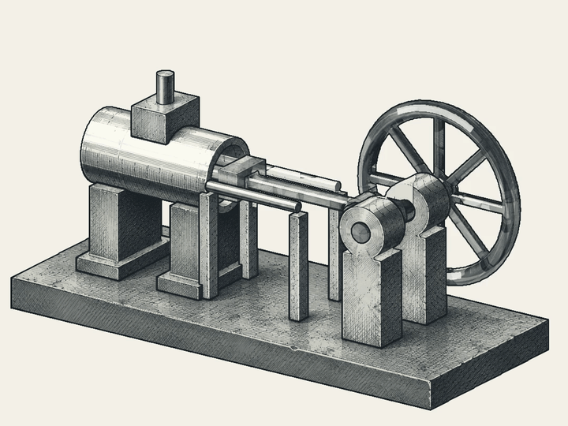
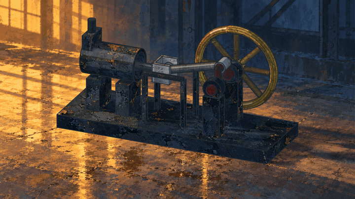
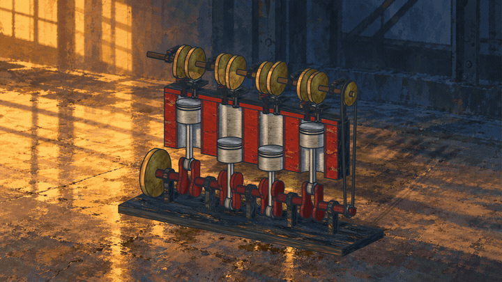

# Mechanical animation teaching cases

English · [简体中文](zh-CN/doc/cases.md)

## Ink and painted steam-engine comparison

| Ink animation | Painted steam engine |
| --- | --- |
|  |  |

The paired examples teach the progression from mechanical line work to painted
materials, lighting and environment. Watch the piston, connecting rod and flywheel
first, then compare contours, surface marks, contact shadows and the background.
Each retained clip has its own framing and timing. The comparison illustrates
presentation choices; exact frame-equality evidence below concerns each painted
reference and its newly rendered reproduction.

| Aspect | Ink example | Painted example |
| --- | --- | --- |
| Visual emphasis | Silhouette, mechanism and ink hatching | Surface material, warm/cool light and workshop context |
| Teaching focus | Follow the mechanical cycle through readable lines | Keep motion and shape stable while enriching appearance |
| Retained public media | Animated GIF | Six-second looping GIF |
| Current evidence | Retained visual demonstration | Rebuilt geometry and poses, fresh rendering and reopened editable scene |

## Build the workflow

1. **Define the mechanism.** Assign stable part IDs, units, local geometry and
   joints. Record the chosen CAD or procedural source and its hash. Preserve
   native CAD when supplied by the generator.
2. **Generate rigid poses with Python.** Calculate one transform per part per
   frame. Check rod closure, joint alignment and the declared clearances before
   rendering. For a slider-crank with crank radius `r`, rod length `l` and crank
   angle `theta`, an illustrative slider coordinate is
   `x = r*cos(theta) + sqrt(l*l - r*r*sin(theta)**2)`, with `l > r`.
   The scene's origin, axes and joint offsets determine its actual transforms.
3. **Prepare the appearance.** The retained painted workflow uses an AI-created
   four-quadrant material atlas for iron, brass, steel and red paint, plus a fixed
   workshop background. Request flat surface swatches with consistent scale and
   keep mechanical components out of the texture image. For the background,
   preserve the approved camera and lighting and remove machinery from the plate.
   Record prompts, selected images and their hashes.
4. **Bind materials and render.** Apply the atlas through UV coordinates. Blender
   applies supplied part transforms and renders contours, shading and contact
   shadows. Verify geometry, UVs, camera and stationary environment throughout.
   A moving camera requires a separately prepared background or environment.
5. **Save editable work and export.** Save a packed Blender scene, PNG sequence,
   MP4 and editing master. Reopen the scene and verify every saved pose, image
   binding and geometry check. The steam example renders 72 poses at 12 fps and
   holds each frame twice for a six-second, 24 fps film.

Preserve the source identity, material approval and render recipe together. A
style change can reuse selected motion; a geometry change needs renewed geometry
and motion checks. Rendering and export reuse Blender and FFmpeg. An external
harness can prepare bounded edits and request these tools through the host.

## Supplementary case — inline-four



The educational inline-four assembly expands the same workflow to 40 CAD parts,
four pistons, eight valves and a camshaft. FreeCAD exports native solids and STEP,
plus meshes and 192 poses. Two crankshaft turns and one camshaft turn cover the
eight-second cycle at 24 fps, with firing order 1-3-4-2.

Geometry and prescribed motion are case-owned. The painted materials, background,
rendering and export workflow are reused. The source checks include 1,441 motion
samples and selected first-cylinder solid intersections at 16 poses. Dimensions
are illustrative. The scope is prescribed kinematics and sampled clearances;
combustion, loads and whole-assembly continuous collision remain outside these
checks.

## Reproduction evidence and a viewing exercise

On 2026-11-08 both supplied painted films were located in their original local
source directories by SHA-256. The reproduction used Blender 5.2.3 and retained
AI images, with zero new image-generation calls.

| Check | Steam | Inline-four |
| --- | --- | --- |
| Regenerated meshes and poses | Byte-identical to source | Byte-identical to source |
| Source checks | 54 passed | CAD validity, motion and sampled solid checks passed |
| Saved poses checked after reopening | 72 | 192 |
| Decoded frames identical to supplied film | 144 / 144 | 192 / 192 |
| Delivery | 1920 × 1080, 24 fps, 6 s | 1920 × 1080, 24 fps, 8 s |

The existing film kit's seven tests passed. Exact decoded-frame equality was
measured for this run and toolchain. Video container hashes can differ after
encoding, so record file identity and decoded-image comparisons separately.

The two painted GIF previews use 720 × 405 at 12 fps and loop their complete
six- and eight-second cycles. They contain 72 and 96 frames respectively.
The reproduction measurements above apply to the original 1080p MP4 deliveries.

From the repository root, inspect a published GIF with FFprobe and record its
decoded frame hashes with FFmpeg.

```sh
ffprobe -v error -select_streams v:0 \
  -show_entries stream=width,height,r_frame_rate,nb_frames,duration \
  -of json assets/demos/painted-steam-engine.gif
ffmpeg -v error -i assets/demos/painted-steam-engine.gif \
  -map 0:v:0 -f framemd5 steam-frames.md5
```

Repeat for `assets/demos/painted-inline-four.gif`. To assess a new render, compare
frame count, presentation timing and per-frame decoded hashes with its selected
reference. Review motion dynamically and inspect the reopened editable scene.

This repository publishes the GIF previews and teaching notes. Full generators,
painting assets, MP4 deliveries, editable scenes and raw reproduction receipts currently live
in the local lab package. A distributable, reviewed animation spool is pending.

## Integration exercise

Package domain instructions and acceptance in an-spool through Loom. Pass a
bounded appearance task to an external harness under an-agent's task authority.
Run through the existing macOS service, `ExecutionBackend` and original
supervisors. Shuttle owns the application handoff for approved editable output.

Label authorized changed or new files as kit and retain protected instructions.
Exercise supplemental instructions, cancellation, service restart, acceptance
and reclamation. Preserve uncertain executions for reconciliation. A completed
film must link back to its selected inputs and original execution record.
This lifecycle acceptance remains pending. See [status](status.md),
[task permissions](execution.md) and [content labels](spool-code.md).
