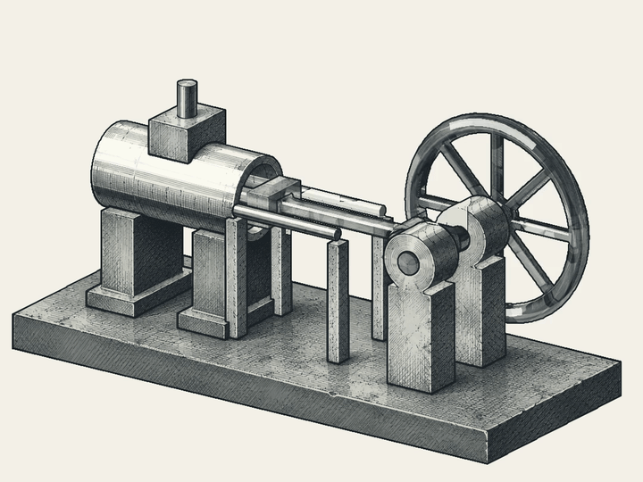

# 一个代理

[English](../../README.md) · 中文译文，以英文为准。

<p align="center">
  
</p>

一个实验性的 Rust 框架，用于将事件驱动的代理嵌入到现有应用程序中。

与其让人们通过一个独立的 AI 接口工作，an-agent 探索代理如何直接参与普通的软件工作流程。对文档、模型或画布的更改可以触发有限的协助，而无需为每个操作都输入新的提示。

应用程序仍然是工作环境。宿主拥有执行权限，用户保留对其可编辑文档的控制权，代理则通过明确声明的能力进行操作。

该框架提供了执行协调、语义评估、监督和可检查的证据。它并不假设记录的操作是可逆的，外部状态总是可以恢复，或仅靠语义检查就能提供安全边界。

这是一项早期的库和集成工作，而不是一个完成的创意应用。

一个 **spool** 是领域执行隔离和生命周期边界；内部的 **silks** 实现其可调用的步骤。本地审核的无头执行是当前的交付重点。OpenShell 仍然是一个可选的、可替换的后端，其扩展已暂停；应用程序穿梭仍然是宿主授权的外部桥梁。无头并不意味着可信代码，且隔离不足时必须拒绝执行，而不是回退到较弱的后端。
请参阅 [实现审计和分阶段迁移](doc/architecture.md)。
OpenShell 的受限文件配置文件不提供原生 spool 状态/事件/产物合同。

[spool 内容合同](doc/spool-code.md) 标记每个发布的基线文件为 **silk**，并标记授权的工作副本或新生成的产物为 **kit**。
指令保持受保护；程序和配置可能包含已批准的 kit 复制件。标签描述了来源和生命周期，而不是执行权限。
旧的目录/API 名称和合格的配置文件限制仍然兼容。

## 当前演示



一个机械绘图实验将规定的机械运动与绘图处理分离。几何提供姿态和可见性；墨水处理则跟随这些姿态。工作成果包括可编辑的 SVG 和分层的 OpenRaster 绘图。AI 生成的位图参考贡献表面外观，而不是机械的运动。

这是一个独立的工作流程原型，用于指导框架的发展方向，而不是 Rust 内核的端到端功能。墨水研究展示了单个操作周期的四次重复，而不是装配序列或力模拟。它并未展示任意绘画编辑的自动传播、实时 CAD 同步或从事件日志中完全恢复。

## 文档

首先查看 [公开文档](doc/README.md)，了解架构、spool/silk 执行边界、状态/产物所有权和实现状态。详细的合同仍然位于实现它们的 crate 旁边。

[原生工作区事件合同](doc/native-events.md)
将接受的文件版本与明确批准的无头 spool 交付连接起来。业务流程仍保留在 silks/kits 中；宿主不会添加任何业务图 DSL。

## 架构和当前能力

宿主应用程序拥有工作区、用户交互以及执行应用程序特定效果。今天，spools 是具有声明合同和配置的嵌入式能力体。目标打包模型是一个可重用的工作流包，包含阶段、silk、配置和文档；它请求 shuttle 能力，而不是必须包含 shuttle。一个 spool 携带领域知识、业务规则、技能和领域接受标准；宿主提供通用的执行和产物管理，而不是吸收这些规则。包标识、一个工作流运行和一个单独的阶段是不同的。现有的描述符和挂载 API 不会因这个设计方向而改变。

Loom 拥有开发和打包。一个代理宿主拥有工作流准入、作用域上下文/模型服务和已验收的产物；一个执行后端强制隔离并拥有 VM/进程生命周期。Shuttles 仍然是应用程序侧的桥梁，而不是不受限制的宿主壳。参见 [责任和权限边界](doc/architecture.md) 和 [本地 VM 方向和能力限制](doc/openshell.md)。本地执行是优先事项；不需要远程编排平台。

- **工作区集成：** 事件、配置、环境快照和注册提供了面向宿主的上下文。工作区是交互中心；其持久化文档和资产仍然是关键输入。
- **代理执行：** `AgentControl` 协调挂载的主体、模型和工具边界、钩子以及记录的执行结果。宿主提供模型客户端和原生集成。
- **语义检查：** 一个独立的 crate 表示声明、具体尝试、版本绑定的授权、收据、合同评估和依赖项有效性。它不拥有业务调度或用户交互。受信任的适配器决定哪些证据和执行是实际可用的。
- **监督：** 需要审核的操作可以交由实时监督者处理。审批绑定到具体操作和当前权限；明确拒绝或缺失的权限无法通过审批绕过。对相关实时状态的更改会使得受影响的审批失效。
- **审计和有限恢复：** 只追加的磁带保留执行证据，而会话 API 支持有限恢复，并且所需输入可用。依赖项检查可以隔离过期的模型结果，而不是将其视为当前工作。
- **有限 CLI 宿主：** `an-agent-host` 独立注册哈希绑定的部署，并通过准入、合格的原生后端限制和保留的收据运行显式的 stdio 仅能力。开发和打包工具不是运行时依赖项。参见 [宿主执行合同](crates/an-agent-host/README.md) 和 [平台支持矩阵](doc/platforms.md)。

绑定发布的原生spools也支持显式的workspace-event交接和
[操作员选择的Python与二进制产品](doc/native-spool.md)。
无头日志报告示例通过相同的监督和托管边界生成可编辑的XLSX/PPTX；文档规则仍保留在spool代码中。
一个可选的[独立状态输入](../native-state.md#independent-business-data-and-state)
将固定业务产物和已提交的检查点绑定，而无需隐式的HEAD选择；预期版本提交和取消保留仍由宿主拥有。

语义评估和执行强制是不同的。宿主或监督代理决定如何响应发现结果；受信任的执行边界强制执行权限。声明或记录的收据本身并不是操作系统沙箱。

## 边界

磁带是一种审计记录，而不是对整个世界的备份。它无法重建缺失的spool实现，恢复不可用的模型或外部服务，也不能保证在长时间后忠实恢复。保留所需的包、工作区资产和兼容的依赖项仍然是部署者的责任。

内容寻址的工作区存储不是一个完整的文档版本控制或回滚系统。内存溯源无法建立真实性或校准的置信度评分。外部影响不会自动可逆或安全重试。通用静态影响推断、全面的系统隔离、持久的审批恢复、分布式执行以及无缝的创意工具集成仍然是待完成的工作。

## 布局

- `crates/an-agent-core` — 核心：磁带、准入、身份、`AgentControl`、座位，以及记录器文件工作区。
- `crates/an-agent-host` — 嵌入辅助工具、磁带构造、回复意图执行，以及模型客户端适配器。
- `crates/an-agent-semantic` — 传输中立的声明、具体尝试、版本绑定的评估、授权以及执行收据。它不拥有调度或中断功能。核心执行边界保留证据，并返回被阻塞操作的监督请求。
- `crates/an-agent-supervision` — 传输中立的实时审查状态和精确的一次性批准。它不拥有磁带、执行或调度功能；核心将受信任的执行边界适配到它。
- `crates/an-agent-spool` — 能力磁带：YAML 描述符准入和只追加磁带注册表。
- `crates/an-agent-workspace` — 内容寻址存储。它不是记录器工作区。
- `packages/causal-web` — 无依赖磁带查看器：将 `.jsonl` 磁带放入其中，查看因果线程，实现磁带在页内验证。
- `packages/lean-probe` — 来自 Lean 4 兼容性实验的微型 Lake 包（不包含 Mathlib）。
- `doc/` — 公共架构、执行、状态/产物和实现状态指南。
- `config/` — 模型端点配置。
- `assets/demos/` — 展示媒体，与运行时能力分开。

## 开发

```sh
cargo check --workspace --all-targets
cargo test --workspace
cargo clippy --workspace --all-targets
cargo fmt --all -- --check
cargo arch
```

工具链通过 `rust-toolchain.toml` 固定。实验部分位于产品依赖图之外。应通过经过测试的实现来推广已验证的集成，而不是将成功的独立演示视为内核的保证。

参见 [架构门控](doc/quality.md) 了解 TOML 规则、现有债务基线、依赖边界以及独立锁定的 SPACE 基础检查器。

[实现边界审计](../architecture.md#implementation-boundary-audit) 映射当前模块与开发人员、宿主和后端的责任，并记录剩余的限制。

参见 [Weaver 与独立 spool 开发](doc/weaver.md) 了解独立迭代与平台管理执行之间的分离。

## 中文文档目录

以下译文与原英文文件一一对应。运行命令、接口和行为约定以英文原文为准。

- [an-agent — 工作协议](AGENTS.zh-CN.md) · `AGENTS.md`
- [an-agent-core](crates/an-agent-core/README.md) · `crates/an-agent-core/README.md`
- [act](crates/an-agent-core/src/act/README.md) · `crates/an-agent-core/src/act/README.md`
- [agent](crates/an-agent-core/src/agent/README.md) · `crates/an-agent-core/src/agent/README.md`
- [det_seam](crates/an-agent-core/src/det_seam/README.md) · `crates/an-agent-core/src/det_seam/README.md`
- [memstream](crates/an-agent-core/src/memstream/README.md) · `crates/an-agent-core/src/memstream/README.md`
- [主体](crates/an-agent-core/src/principal/README.md) · `crates/an-agent-core/src/principal/README.md`
- [录音员](crates/an-agent-core/src/recorder/README.md) · `crates/an-agent-core/src/recorder/README.md`
- [seat](crates/an-agent-core/src/seat/README.md) · `crates/an-agent-core/src/seat/README.md`
- [an-agent-host](crates/an-agent-host/README.md) · `crates/an-agent-host/README.md`
- [宿主 CLI 接受](crates/an-agent-host/tests/cli/README.md) · `crates/an-agent-host/tests/cli/README.md`
- [an-agent-semantic](crates/an-agent-semantic/README.md) · `crates/an-agent-semantic/README.md`
- [依赖检查测试](crates/an-agent-semantic/src/dependency/README.md) · `crates/an-agent-semantic/src/dependency/README.md`
- [an-agent-spool](crates/an-agent-spool/README.md) · `crates/an-agent-spool/README.md`
- [spool](crates/an-agent-spool/src/README.md) · `crates/an-agent-spool/src/README.md`
- [一个代理监督](crates/an-agent-supervision/README.md) · `crates/an-agent-supervision/README.md`
- [an-agent-workspace](crates/an-agent-workspace/README.md) · `crates/an-agent-workspace/README.md`
- [workspace](crates/an-agent-workspace/src/README.md) · `crates/an-agent-workspace/src/README.md`
- [an-agent 文档](doc/README.md) · `doc/README.md`
- [架构与词汇](doc/architecture.md) · `doc/architecture.md`
- [艺术品版本、固定输入和受控访问](doc/artifacts.md) · `doc/artifacts.md`
- [实例提交和检查点交付](doc/checkpoints.md) · `doc/checkpoints.md`
- [核心身份与记录合约](doc/core-contracts.md) · `doc/core-contracts.md`
- [执行与权威](doc/execution.md) · `doc/execution.md`
- [模型、上下文和编码工具服务](doc/model-services.md) · `doc/model-services.md`
- [注册的原生部署](doc/native-deployment.md) · `doc/native-deployment.md`
- [原生工作空间事件](doc/native-events.md) · `doc/native-events.md`
- [原生 spool 运行时和轮次控制](doc/native-spool.md) · `doc/native-spool.md`
- [原生状态和发布变更](doc/native-state.md) · `doc/native-state.md`
- [原生存储、私有集合和产物准入](doc/native-storage.md) · `doc/native-storage.md`
- [可选OpenShell后端](doc/openshell.md) · `doc/openshell.md`
- [平台支持与资格认证](doc/platforms.md) · `doc/platforms.md`
- [开发者资格配方](doc/qualification.md) · `doc/qualification.md`
- [仓库架构门禁](doc/quality.md) · `doc/quality.md`
- [艺术品保留和运行时所有权](doc/session-and-retention.md) · `doc/session-and-retention.md`
- [轮廓内容标签：丝线和套件](doc/spool-code.md) · `doc/spool-code.md`
- [状态、制品和历史](doc/state-and-artifacts.md) · `doc/state-and-artifacts.md`
- [实现状态和下一步计划](doc/status.md) · `doc/status.md`
- [测试与跨仓库验证](doc/testing.md) · `doc/testing.md`
- [Weaver 与独立 spool 开发](doc/weaver.md) · `doc/weaver.md`
- [已审查的执行配置和进程所有权](doc/workspace-jobs.md) · `doc/workspace-jobs.md`
- [可选的 Linux 开发机](infra/dev/lima/README.md) · `infra/dev/lima/README.md`
- [causal-web](packages/causal-web/README.md) · `packages/causal-web/README.md`
- [lean-probe](packages/lean-probe/README.md) · `packages/lean-probe/README.md`
- [ts-tools](packages/ts-tools/README.md) · `packages/ts-tools/README.md`
- [spools — spool库](spools/README.md) · `spools/README.md`
