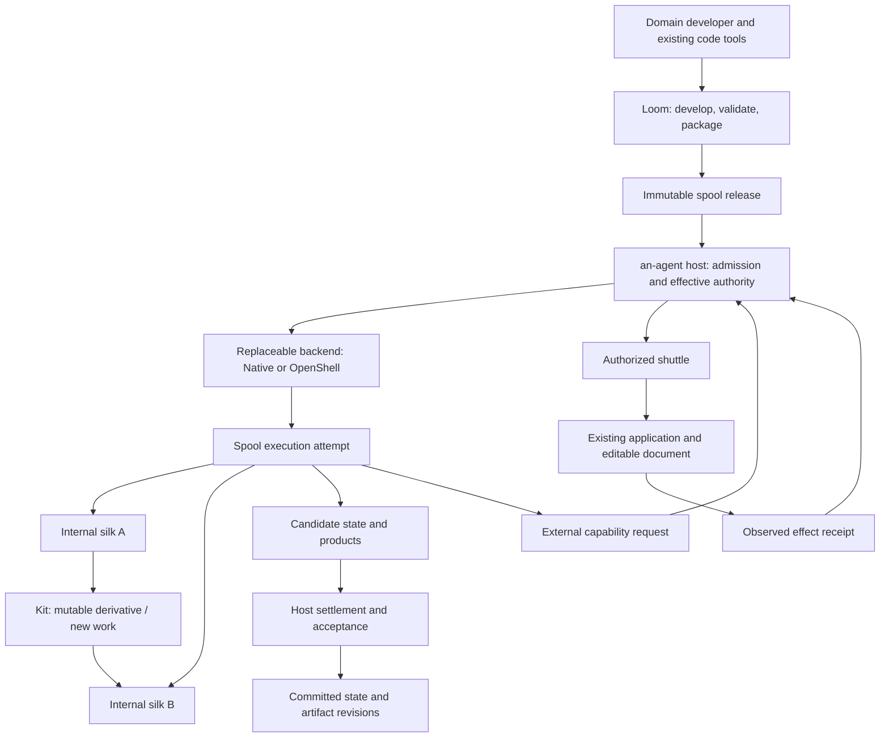

# 架构与词汇

[English](../../architecture.md) · 中文译文，以英文为准。 · [中文目录](../README.md)

目标是在现有应用程序中提供自然辅助。用户在文档、模型和画布上工作；宿主提供绑定上下文并请求有用的工作。当意图或权限需要澄清时，文本交互仍然可用。领域算法不属于内核。

## 责任

| 组件 | 责任 |
| --- | --- |
| an-agent host | 接收和授权、模型/上下文服务、执行身份、生命周期协调、已提交状态、已验收的产物、交付和保留证据 |
| 核心 | 已有事件/磁带、身份和接收/控制原语；不作为领域管道引擎或虚拟机管理器 |
| Spool release | 不可变的领域代码、内部丝线、技能、依赖项、状态格式和领域验收规则 |
| Spool instance | 一个绑定释放的业务身份，具有已提交状态 |
| Spool execution attempt | 执行隔离、权限和生命周期的目标单元 |
| Silk | 每个不可变的释放基准文件，包括程序、配置和指令 |
| Kit | 被授权的可变衍生品和新工作；标签描述来源，而非授权 |
| Shuttle | 一个被授权的桥梁进入外部应用程序，具有修改前提条件和观察结果 |
| 执行后端 | 实际的隔离和进程/环境控制；OpenShell 是一个可选实现 |
| an-loom | 开发者工作台，用于编写、代码工具辅助、检查和打包；从不运行时授权 |

## 目标责任模型

现有的单入口配置仅覆盖有限的特化。在进程中的 `SpoolBeat` 体保持信任的嵌入代码；挂载一个声明不会将该代码隔离。原生的外观能够满足有限多丝 CLI 执行；任意代理的容器化和通用多后端 spool ABI 仍未实现。

## 局部执行策略

Spool 交互是工作区事件路由，而非宿主业务流程图。silk/kit拥有领域分支、循环和委托决策。宿主拥有订阅、准入、尝试监督和固定版本交付证据。[原生事件切片](native-events.md)连接已接受的构件事实到分别批准的原生尝试通过显式前台调度。它不添加图 DSL、后台调度器或低延迟通道。[原生 Python 扩展](native-spool.md)将操作者选择的环境和显式二进制产品绑定到同一边界。Spool 包声明请求；本地运行时选择和授权仍由宿主拥有。子代理使用相同的权威边界；Shuttle保持外部应用程序桥梁。未来高频数据需求需单独授予通道，而非强制每样本进入持久工作区日志或磁带。

拥有轻量级 spool 执行管理器，而非新的容器实现。首先重用原生后端，与独立拥有并发尝试。未来容器或微VM适配器提供执行和生命周期证据；宿主继续拥有授予、接受版本和跨 spool 交付。身份、业务状态、活进程状态和文件系统备份是不同的。重启选择显式输入/状态，创建新尝试。

## 依赖和信任方向

运行时 crate 不依赖 Loom 或领域流程示例。领域序列和检查保持在 spool 中。宿主无需解释业务状态以保留和版本它。后端特定的策略/状态由宿主适配器翻译；不进入纯语义 crate。

Spool 请求能力；宿主授予它们。包指令、源分析报告、生成的 YAML 和模型发现不能创建授权。丝线不能选择较弱的后端或直接写入正式目录。后端支持必须针对其平台、版本和有效策略进行资格认证。当要求无法强制执行时，没有静默的较弱回退。

[spool 代码契约](spool-code.md)标记不可变的发布文件丝线和可变衍生品/新工作套件。这是目标契约，而非新的可变代码执行。遗留 `file-kit-v1`，CLI 命令，`kit.*` 事件、路径和兼容性 API 保留其拼写。历史丝线通信协议/Silksong 记录是不同模式，非可执行丝线；不通过命名变更重写历史。

对于详细审计和迁移，请参见 [spool 边界](architecture.md)。

| 模块 | 自有 | 不能拥有 |
| --- | --- | --- |
| `execution/deployment.rs` | 部署验证和不可变注册 | 执行授权或域编译 |
| `execution/mod.rs` | 公共入口点和显式后端选择 | 内联后端实现或包装策略 |
| `execution/attempt.rs` | 输入选择、分配锁、操作身份、后端结果 reconciliation、输出接受和接收 | 域算法或后端隔离机制 |
| `execution/admission.rs` | 核心请求/回复验证和同一尝试的最终账本/审计结算 | 进程启动或制品接受 |
| `execution/backend/` | 本机/开放壳层翻译到现有执行契约 | 释放装配或独立授权 |
| `settled_run`, `instance`, `artifact_versions`, `retention` | 证据门、已提交状态、产品托管和收集 | 域状态解释或自动恢复外部效果 |

尝试的承认身份通过接收生产进入审计结算。排序不变：选定输入和计划、核心承认、操作意图、可执行发布、后端结果 reconciliation、候选接受、接收、审计和最终结算密封。部分完成不是已结算运行。共享分配锁仍会在独立执行前结束；此重构添加了没有全局生命周期锁、重试或较弱的回退。

Loom的宿主适配器被故意耦合到合格的CLI/接收格式。这是开发客户端依赖，而非运行时所有权。离线源检查和构建-接收验证不作为沙箱强制执行。宿主仍决定接收的发布和请求执行是否可接受。

### 本重构保留的限制

- 可信的在进程内 `SpoolBeat` 嵌入和隔离CLI尝试保持为独立路径。声明不沙箱一个在进程内的主体。
- 旧部署仍支持受限一程序配置文件。本机面罩添加声明的silk/kit快照和批准跨运行编辑，而非通用可变代码或敌对代理执行契约。
- Loom的宿主CLI传输被信任的操作工具，而非为模型选择的可执行程序的沙箱。其响应大小检查发生在捕获之后。
- 无网络格式、旧名称、CLI、权限范围或域接受规则未迁移此处。新配置必须在扩展接口前获得集成证据；通用插件/控制平面框架不是必要条件。

## 注意力不是权威

| 问题 | 权威和机制 |
| --- | --- |
| 一个已知依赖是否需要更新？ | 显式应用程序依赖、输入修订和无效化规则 |
| 现在是否值得提议一些可替换的、受限的规则或学习的策略？ | 返回候选请求的可替换、受限的规则或学习的策略 |
| 那个请求是否可以执行或披露数据？ | 宿主承认和授权，再次在实际执行/模型边界检查 |

学习的相关性分数必须不抑制必需的依赖无效化、审计证据、取消或执行。反之，依赖变更不授权立即昂贵的工作：宿主可合并、延迟或拒绝与过时修订相关的产物。本地预览循环仍与较慢代理推理分开。

注意选择候选；它不授予能力、重写角色、静默地在受众之间移动上下文、选择密钥或覆盖拒绝。相关性、事实信心、来源和权限是不同概念。高相关性不能将不可信的源文本转化为指令。

## 未来注意力消费者的要求 /no_output

使用应用程序提供的原生对象身份和修订号。
名称、路径、别名和文本提取的实体是适配器观察结果，而非权威对象身份。对象在特定事件/修订号下的相关性；不应将最后一个标签视为对象的永久属性。

候选者必须保持可追溯到其观察结果、输入修订号、策略身份和预期受众。执行仍需自己的批准计划。不应让可选策略抹去跳过或过时请求的证据，或修改已记录的事实。保持原始高频UI样本在应用边缘；仅适当的有限事实跨越宿主边界。

当真实跨应用消费者需要时，应以明确的订阅、合并和有限规则开始。将任何学习到的策略与有用的接受工作、遗漏更新、假中断、陈旧性、延迟和总模型/上下文成本进行比较。触发阶段的延迟不是端到端任务延迟或令牌节省保证。

[时间图触发和路由](https://arxiv.org/abs/2605.30152) 是一种设计参考，用于分离注意力和生成。该论文中任何实现或基准结果均未在此处纳入。在引入GNN或通用工作流程框架之前，应由独立消费者证明其必要性。

## 上下文、消息和工作所有权

这些设计规则指导新消费者；它们不声称拥有通用上下文路由器或自动恢复实现：

1. **在检查可见性后选择上下文。** 在总结或分页前，将选定的材料绑定到其来源、修订号、目的和受众。派生摘要继承来源的披露限制。优先使用有限视图和显式的读取指针，而非将整个历史复制到模型中。
2. **分离上下文、请求和授权。** 订阅交付信息；它不能扩展权限或把源文本转化为指令。工作区保存版本化材料和共享事实。定向的分发通信使用授权协议，包括当文件携带其信封。
3. **区分授权起源与事件所有权。** 记录工作为何被接纳以及适用的策略/授权，与谁处理、确认或返回事件无关。关联增加证据，而非权限。
4. **分离工作与执行。** 持续任务持有其目标、范围和交接状态。每次尝试绑定精确输入/状态、有效权限和终止证据。未完成的任务从不授权重放未知尝试。恢复建议可请求检查；但不授予执行或收集权限。

织者和可插拔的钩子可能提供角色提示、上下文分页、人工手off和恢复建议。宿主执行访问、接纳、执行和保管。Loom包定义域代码和声明；它不拥有模型循环或运行时策略。操作系统线程和资源拥有会话不应与由编码应用称为“Thread”的讨论时间线混淆。

设计参考：[dsh-superagent-prototype at 6337fc8](https://github.com/deepseek-ai/dsh-superagent-prototype/tree/6337fc823ce20251c8de8085948165c81aaa701e)，尤其是其域、授权和执行文档及其效果队列。当出现匹配需求时，应查阅其机制和测试。其全权限执行器和重启驱动重新分配不属于我们的隔离或恢复契约。此参考不添加依赖、源代码导入或GitHub/Feishu集成；这些应用是可选的未来资格案例。

嵌入式 harness 的边界见[守护服务契约](daemon.md)。
Codex app-server 负责推理与会话管理。宿主签发的任务权限及现有 spool
执行监管器负责工具与文件的授权。Weaver 在 Loom 开发流程中使用同一可替换 harness。
