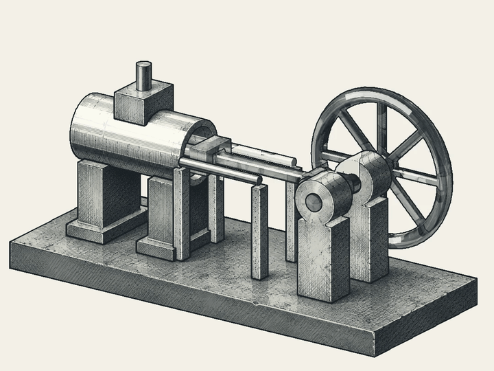
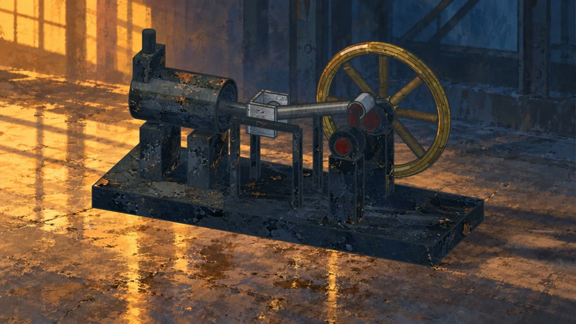
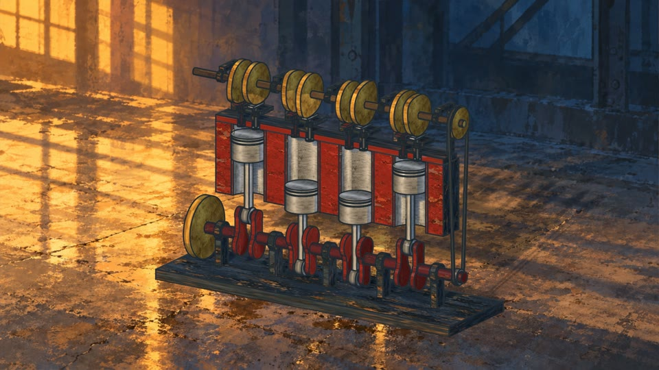

# 机械动画教学案例

[English](../../cases.md) · 简体中文

## 水墨动画与手绘蒸汽机对比

| 水墨动画 | 手绘蒸汽机 |
| --- | --- |
|  | [](../../../assets/demos/painted-steam-engine.mp4) |

这组对比展示从机械线条到材质、光照与环境的表达过程。先观察活塞、连杆和飞轮的配合，
再比较轮廓、表面笔触、接触阴影和背景。两段保留各自的镜头构图与时序。
这里用来理解画面处理的变化，下文的逐帧一致性检查针对每段手绘原片与本轮重新渲染的成片。

| 方面 | 水墨版本 | 手绘版本 |
| --- | --- | --- |
| 视觉重点 | 轮廓、机构和排线 | 表面材质、冷暖光与厂房环境 |
| 教学重点 | 通过清晰线条读懂机械周期 | 丰富外观时保持运动和形状稳定 |
| 仓库展示素材 | 动态 GIF | 6 秒 1080p MP4 与预览图 |
| 当前证据 | 保留的视觉演示 | 几何与姿态重建、重新渲染、可编辑场景回读 |

## 制作流程

1. **定义机构。** 给零件分配稳定标识，明确单位、局部几何和关节。记录选定的 CAD 或程序几何来源
   及其哈希。生成器提供原生 CAD 时一并保留。
2. **用 Python 计算刚体姿态。** 每帧为每个零件输出变换矩阵。渲染前检查连杆闭合、关节对齐和
   已声明的间隙。以曲柄半径 `r`、连杆长度 `l`、曲柄角 `theta` 为例，滑块坐标可写成
   `x = r*cos(theta) + sqrt(l*l - r*r*sin(theta)**2)`，条件为 `l > r`。
   实际矩阵还要结合场景原点、坐标轴和关节偏移。
3. **准备外观。** 原手绘流程使用 AI 生成的四分区材质图，分别表示铸铁、黄铜、钢和红漆，
   再配固定厂房背景。提示词要求平面材质样本、统一纹理尺度，避免在纹理里画入机械零件。
   背景保留选定镜头和光照，移除机器。记录提示词、选定图片与哈希。
4. **绑定材质并渲染。** 通过 UV 使用材质图，Blender 应用输入的零件姿态，生成轮廓、明暗和
   接触阴影。全过程检查几何、UV、相机和静态环境。相机运动需要单独准备背景或三维环境。
5. **保存可编辑产物并导出。** 保存打包图片的 Blender 场景、PNG 序列、MP4 和编辑母版。
   重新打开场景，检查全部保存姿态、图片绑定和几何。蒸汽机以 12 fps 渲染 72 个姿态，
   每帧重复两次，得到 6 秒、24 fps 成片。

源文件身份、材质选择与渲染配方应一起保留。修改画风时可复用选定运动，修改几何时需重新检查
几何和运动。渲染与导出复用 Blender 和 FFmpeg，外部 harness 可准备限定范围的修改，
再通过宿主调用这些工具。

## 补充案例 — 四缸发动机

[](../../../assets/demos/painted-inline-four.mp4)

教学用四缸机构把同一流程扩展到 40 个 CAD 零件、4 个活塞、8 个气门和凸轮轴。
FreeCAD 输出原生实体、STEP、网格与 192 个姿态。曲轴两圈、凸轮轴一圈构成 8 秒周期，
24 fps，点火顺序为 1-3-4-2。

几何和既定运动由案例负责，手绘材质、背景、渲染及导出流程复用。
源检查覆盖 1,441 个运动采样，以及第一缸选定实体对在 16 个姿态下的相交检查。
尺寸用于教学示意，验收范围为既定运动和采样间隙。燃烧、载荷与整机连续碰撞需要另外验证。

## 复现证据与观察练习

2026-11-08 通过 SHA-256 找到两段手绘视频对应的原始本地目录。
本轮使用 Blender 5.2.3 和原 AI 图片，新增图片生成调用为零。

| 检查 | 蒸汽机 | 四缸发动机 |
| --- | --- | --- |
| 重新生成的网格与姿态 | 与原输入逐字节一致 | 与原输入逐字节一致 |
| 源检查 | 54 项通过 | CAD 有效性、运动与实体采样检查通过 |
| 重新打开场景后检查的姿态数 | 72 | 192 |
| 解码后与原片一致的帧数 | 144 / 144 | 192 / 192 |
| 交付规格 | 1920 × 1080、24 fps、6 秒 | 1920 × 1080、24 fps、8 秒 |

既有短片工具的 7 项测试通过。逐帧一致性是本轮工具链下的实测结果。
重新编码后视频容器哈希可能变化，应分别记录文件身份与解码图像对比。

在仓库根目录使用 FFprobe 检查公开成片，用 FFmpeg 记录解码帧哈希。

```sh
ffprobe -v error -select_streams v:0 \
  -show_entries stream=width,height,r_frame_rate,nb_frames,duration \
  -of json assets/demos/painted-steam-engine.mp4
ffmpeg -v error -i assets/demos/painted-steam-engine.mp4 \
  -map 0:v:0 -f framemd5 steam-frames.md5
```

换成 `assets/demos/painted-inline-four.mp4` 可检查补充案例。评估新渲染时，比较帧数、播放时序
和每帧解码哈希，动态观看运动，并检查重新打开的可编辑场景。

本仓库发布成片和教学说明。完整生成器、绘画素材、可编辑场景与原始复现记录目前保存在本地
实验包中。可分发、经过审阅的动画 spool 待完成。

## 接入练习

通过 Loom 将领域指令和验收打包到 an-spool，在 an-agent 任务权限下向外部 harness 委派
有限外观修改。执行复用现有 macOS 服务、`ExecutionBackend` 和原执行者监督。
Shuttle 负责已验收可编辑产物的应用交付。

获准修改或新增的文件标为 kit，指令文件保持受保护。依次验证补充指令、取消、服务重启、
产物验收与回收。执行结果不确定时保留现场用于核对，成片须追溯到选定输入和原执行记录。
这组生命周期验收待完成。参见[实现状态](status.md)、[任务权限](execution.md)和
[内容标签](spool-code.md)。
